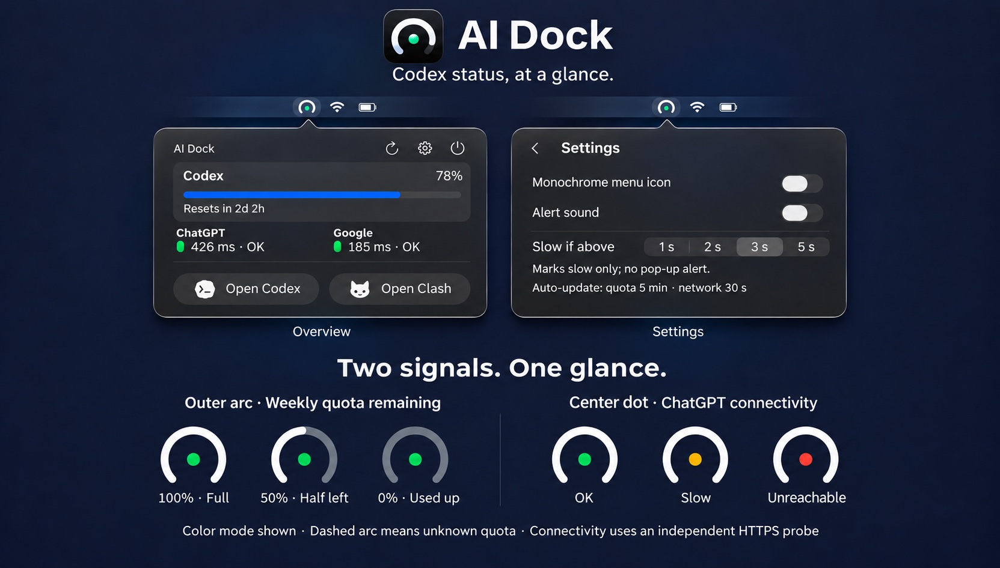
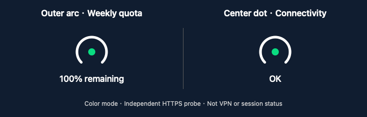

# AI Dock

[](https://github.com/gocat/ai-dock/actions/workflows/ci.yml)

[简体中文](README.md) · English

A native macOS menu bar utility for **Codex weekly quota, independent ChatGPT / Google connectivity checks, quick launchers, and quiet failure reminders**.

**Outer arc for quota. Center dot for connectivity.** A glance at the menu bar shows your remaining Codex weekly quota and the independent ChatGPT connectivity result, without opening the panel. Inspired by **iPhone duo**, the design packs the most useful information into one small icon.

## Quick install

### Ask your AI assistant

Copy this prompt to an AI assistant that can use a terminal on your Mac. A chat-only assistant can instead walk you through the commands:

> Help me install AI Dock on this Mac: https://github.com/gocat/ai-dock. Read README.en.md and install.sh first. Check macOS, Apple Command Line Tools, and the quota-reading dependency, then build from source, run self-tests, install, and open the app. Do not change my network settings, accounts, or credentials. If system tools or terminal access are missing, explain the required steps first.

### Or paste into Terminal

```sh
curl -fsSL https://raw.githubusercontent.com/gocat/ai-dock/main/install.sh | bash
```

The script downloads source from this repository, builds and tests it locally, then installs and opens the app. First installs go to `~/Applications/AI Dock.app`; rerunning updates an existing installation while retaining preferences and a backup of the old app. Quit AI Dock before updating. No `sudo` or paid developer membership is needed. You can [inspect the script](install.sh) first.

**Requires macOS 14+, Apple Command Line Tools, and Python 3.** If the compiler tools are missing, run `xcode-select --install`, finish Apple's installer, and rerun the command. The initial tool download can be large; build time depends on your Mac and network. Tested on Apple silicon; Intel is not device-tested.

Quota reads currently use the Codex CLI inside `/Applications/ChatGPT.app` and its existing login. A web account or a separately installed Codex CLI alone does not guarantee compatibility with this fixed path. Without it, quota is unavailable but network checks still work. The installer never requests credentials or changes proxy settings. The proxy launcher defaults to an installed Clash Verge; choose another local app in Settings.

**Why no DMG yet?** Honestly, I don't want to pay Apple's developer membership fee for this little utility right now. Making a DMG is free; developer signing and notarization are what make distribution smoother. For now, asking your AI assistant or pasting one command to build locally is convenient enough. A chat-only AI cannot install it for you, but can guide you.





The animated guide is about 75 KB, with eased transitions and readable holds. The outer arc shows 100%, 50%, and 0% remaining quota. Green, orange, and red center dots mean OK, slow, and unreachable; orange matches the panel swatch. Zero quota does not mean a network failure; unknown quota uses a dashed arc. Examples show color mode, and connectivity does not establish VPN or Codex session health.

Supports light and dark appearances. This showcase renders native views with synthetic example data; the illustration predates the new monochrome Codex and Clash launcher icons. Actual popover material varies with system appearance and background.

## Language

Open Settings and use the labeled Language menu on the left: **System**, **简体中文**, or **English**. Changes apply immediately and are saved locally. System mode uses Chinese when the system's preferred language is Chinese, and English otherwise.

## What it does

- Shows remaining Codex weekly quota, a progress bar, and the reset countdown.
- Independently measures HTTPS response times to ChatGPT and Google.
- Opens Codex and a user-selected proxy app; it does not change proxy settings or connect a VPN.
- Provides manual refresh, monochrome menu bar mode (white: normal, gray: slow, red: unreachable; hollow: not checked), an optional alert sound, and quit confirmation.
- Keeps the overview and settings at the same compact size. Reopening the popover returns to the overview.

Quota refreshes every 5 minutes; network checks run every 30 seconds. Wake from sleep triggers one extra refresh about 5 seconds later, with duplicate wake notifications merged into a single pass. A slow result changes the status only. Connectivity failures never open a modal alert: the menu-bar lamp and the panel are the only signal. The optional alert sound, if enabled, still fires at most once per incident after 5 consecutive failures, with a 30-minute minimum interval; 3 successful checks rearm it. Google never triggers the sound. Reminder state resets when the app restarts.

## Build and run

Requires macOS 14+, Apple Command Line Tools, and Python 3. Only the current Apple silicon development Mac has been device-tested.

```sh
bash build.sh
'build/AI Dock.app/Contents/MacOS/CodexCompanion' --self-test
open 'build/AI Dock.app'
```

The build is locally ad-hoc signed, not Developer ID signed or notarized. No notarized installer is provided. Build scripts regenerate the original application icon; no account credentials or network downloads are needed to compile and run self-tests. Signing happens on a copy in the temporary directory and the finished bundle is copied back, because this source folder sits in a synced location whose metadata is re-added asynchronously. A GitHub Actions workflow (`macos-26`) runs the same build and self-test on every push and pull request; local `--self-test` output should match CI.

Quota reads currently require the Codex CLI bundled at `/Applications/ChatGPT.app/Contents/Resources/codex-cli/bin/codex` and its existing authenticated account. The app invokes `app-server --stdio` and `account/rateLimits/read`; it does not read authentication files directly. The CLI account may differ from the account selected in a desktop UI. Only the reported Codex weekly window is supported. Missing or failed quota data is shown as unavailable.

Select a local proxy application in Settings. Clash Verge is the compatibility default when installed. Dependencies are not automatically installed.

### Check an installed build

```sh
defaults read "/Applications/AI Dock.app/Contents/Info" CFBundleShortVersionString
```

1. **Version**: the command above should print the candidate you installed (adjust the path for a `~/Applications` install).
2. **Menu-bar colours**: the outer arc is the weekly quota; a slow center dot should be the same orange as the panel swatch, with green for normal and red for unreachable.
3. **No alert**: turn off the proxy or disconnect the network, then wait about five 30-second probes or press refresh once. Only the icon and panel should change; no modal alert appears. An enabled alert sound may fire at most once.
4. **Rollback**: quit the app and move the backup directory printed by the installer (`/Applications/.ai-dock-backup.*/AI Dock.app`) back to the original location.

## Network and privacy

| Target | Endpoint | Successful response |
| --- | --- | --- |
| ChatGPT | `https://chatgpt.com/cdn-cgi/trace` | HTTPS 200 from the same host |
| Google | `https://www.google.com/generate_204` | HTTPS 204 from the same host |

Probes use ephemeral URLSession instances without app-supplied credentials or cookies. Response bodies are discarded, not logged. Requests follow system networking and proxy rules; different hosts may take different routes. Reachability does not establish VPN connectivity or Codex session health.

Language, latency threshold, monochrome mode, sound, and a bookmark for the selected app are stored locally. Launch at login is opt-in and managed by the system login-item service. The app does not change login credentials or network settings. This describes the app's code, not a complete traffic audit of the Codex CLI or system dependencies.

## Performance and limitations

The current schedule implies up to 240 HTTPS checks and 12 CLI launches per hour. A single idle sample showed about 57 MiB of memory and 0.0% CPU; this is not a battery-life measurement. A closed popover now only updates the menu-bar item instead of rebuilding its view tree, which changes AppKit work but not the request count. See [performance research](PERFORMANCE.md) for remaining proposals and the validation plan.

Real expired-login cases, extended sleep/wake testing, and broader OS/architecture coverage remain pending. Multi-account, other AI providers, WorkBuddy, Doubao Work, and Windows support are future research, not shipped features. See [product scope](PRODUCT.md) and [validation](VALIDATION.md).

## License

Original project code: [MIT](LICENSE), Copyright (c) 2026 gocat. Third-party trademarks, artwork, and system symbols do not gain additional permissions through this project's license. See [third-party notes](THIRD_PARTY.md).

## 1.0 candidate

Local candidate `1.0.0-rc.9` (build 30) is not a final release. Settings keeps the same panel size and places Back at the overview Settings hit target. Quota reads have an approximately 8-second deadline with child cleanup; network resources time out after 8 seconds, with a 9-second wait fallback. Partial failures stop the spinner without showing a success checkmark. Wake from sleep triggers one coalesced refresh after a 5-second grace period; real lid-close/wake behaviour is still pending hardware validation.
