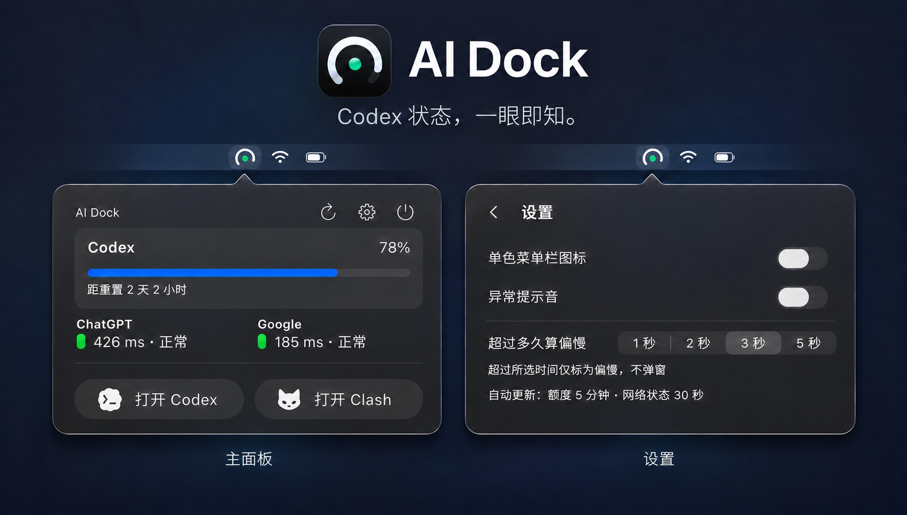
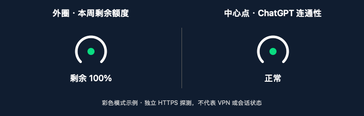

# AI Dock

简体中文 · [English](README.en.md)

一个轻量的原生 macOS 菜单栏工具。当前聚焦 **Codex 周额度、ChatGPT / Google 连通性、快捷启动与低打扰提醒**。

**外圈看额度，中心点看连通性。** 不用打开面板，瞄一眼菜单栏，就能同时知道 Codex 本周还剩多少额度、ChatGPT 的独立连通性检测是否正常。设计灵感来自 **iPhone duo**：用一个小图标传达最重要的信息。

## 快速安装

### 复制给 AI

把下面这句话发给能操作你 Mac 终端的 AI 助手；如果它没有终端权限，让它给你分步命令即可：

> 请帮我在这台 Mac 安装 AI Dock：https://github.com/gocat/ai-dock。先阅读 README 和 install.sh，检查 macOS、苹果命令行工具及额度读取依赖，然后从源码构建、运行自测、安装并打开。不要改动我的网络、账号或凭据；如果需要安装系统工具或缺少终端权限，先告诉我具体步骤。

### 复制到终端

```sh
curl -fsSL https://raw.githubusercontent.com/gocat/ai-dock/main/install.sh | bash
```

脚本从本仓库下载源码，在你的 Mac 上编译、自测、安装并打开。首次默认安装到 `~/Applications/AI Dock.app`；再次运行可更新已有安装，会保留设置和旧版应用备份。更新前先退出 AI Dock。不需要 `sudo`，也不购买开发者会员；可先查看 [安装脚本](install.sh)。

**需要 macOS 14+ 和 Apple Command Line Tools。** 如果尚未安装编译工具，先运行 `xcode-select --install`，完成苹果安装窗口后再重试；还需要可用的 Python 3。首次可能下载较大的编译工具，构建时间取决于电脑和网络。目前在 Apple silicon Mac 验证，Intel 尚未实机测试。

额度读取使用 `/Applications/ChatGPT.app` 内置的 Codex CLI 及其已有登录状态。只有 Codex 网页账号、或单独安装另一种 Codex CLI，并不保证与当前固定路径适配；缺少这个依赖时会显示额度不可用，网络检测仍可用。脚本不会索取登录凭据或改动代理。Clash 启动入口目前要求安装 Clash Verge。

**为什么暂时没有 DMG？** 说白了，我暂时不想为这个小工具付苹果开发者年费。做 DMG 本身不收费，花钱的是让分发更顺畅的开发者签名和公证。这版先让 AI 帮你，或者复制一条命令，在自己的 Mac 上构建安装，也挺方便。普通聊天 AI 不一定能替你操作电脑，但可以指导你完成。

[产品定位与路线图](PRODUCT.md)记录已实现、正在收敛、待验证和远期探索，是后续产品评审与公开说明的依据。多 AI、多账号和通用额度中心目前都不是已交付能力。

## 展示





下方 GIF 约 21 KB。外圈依次示意 100%、50%、0% 剩余额度；中心点的绿、黄、红分别表示正常、偏慢、未连通。0% 表示额度已用完，不等于网络故障；额度未知时使用虚线。图示为彩色模式，连通性结果不代表 VPN 或 Codex 会话状态。

支持深色和浅色模式。上图为 AI 辅助美化展示图，使用示例数据；字体、图标和材质细节有重绘。展示中的应用品牌图标仅用于识别，默认构建使用中性系统图标。

## 语言

设置页右上角可选择“跟随系统 / 简体中文 / English”，即时切换并保存。跟随系统时，首选语言为中文则使用中文，其余使用英文。上方展示图制作于语言选项加入之前。

## 能耗与稳定性

检测不是零成本：当前理论上每小时 240 次 HTTPS 探测、12 次额度 CLI 启动。一次空闲采样约 57 MiB 内存、0.0% CPU，未发现 AI Dock 防休眠断言；这不是续航测量，也不保证所有环境无冲突。[性能与能耗调研](PERFORMANCE.md)列出连接复用、减少隐藏界面重绘、自适应频率、睡眠恢复和子进程回收方案及验证计划，尚未实施这些优化。

## 使用

从“应用程序”打开 `~/Applications/AI Dock.app`（已有全局安装则保留原位置），或点击菜单栏额度弧。应用支持独立退出和重新打开；退出前会确认。现有旧名称快捷入口兼容新安装，应用身份保持不变以保留设置。

- **额度弧**：270° 轨道表示 Codex 周额度剩余；底部留缺口；额度未知使用虚线。
- **状态点**：显示 ChatGPT 独立探测状态，支持单色模式。它不证明 Codex 会话健康或代理已连接。
- **面板**：Codex 标题、右侧剩余百分比和进度条，下方显示重置倒计时；横向的 ChatGPT / Google 检测结果；固定的 Codex、Clash Verge 启动按钮。
- **操作**：刷新显示进行动画，成功后短暂显示勾选，部分失败显示提示标识；设置和退出位于右上角。

## 数据与隐私边界

额度读取通过已安装 ChatGPT 应用内的 Codex CLI 启动 `app-server --stdio`，调用 `account/rateLimits/read`。AI Dock 不直接读取认证文件，登录状态由 CLI 处理。当前没有账号选择或账号归属比对功能，也不能保证 CLI 与桌面界面当前所选账号始终一致。

当前实现选择 `codex` 额度桶中长度为 10080 分钟的窗口。没有对应窗口或读取失败时，不推断余额，显示不可用及读取原因。重置次数只在服务端返回正数时显示；零与不可用目前均隐藏，不把汇总次数擅自归属某个模型。

连通性每 30 秒独立检测一次：

| 目标 | 地址 | 成功条件 |
| --- | --- | --- |
| ChatGPT | `https://chatgpt.com/cdn-cgi/trace` | 最终响应为同主机 HTTPS 200 |
| Google | `https://www.google.com/generate_204` | 最终响应为同主机 HTTPS 204 |

使用临时 URLSession，不携带应用提供的凭据或 Cookie，不记录响应体，沿系统网络及代理规则访问。两个域名可能走不同路线；Google 可达不等于 VPN 已连接。上述描述来自应用代码核查，不等于已对 Codex CLI 或系统网络依赖做完整通信审计。

应用不改变代理连接、网络设置或登录凭据，不默认增加开机启动。当前仅将语言、阈值、单色模式和提示音偏好存入本地 UserDefaults。

## 刷新与提醒

- Codex 额度每 5 分钟读取一次，也可手动刷新。
- 默认慢速阈值 3000 ms，可选 1000 / 2000 / 3000 / 5000 ms。
- 偏慢只显示状态，不弹窗。ChatGPT 连续 5 次失败才提醒；同轮故障一次；连续 3 次成功后重新启用，两次提醒至少间隔 30 分钟。
- 上述提醒计数和冷却只在当前运行期间保存。Google 不增加弹窗提醒。
- 提示音默认关闭；检测仅在应用运行时进行。

## 构建与验证

源码：`Sources/main.swift`；资源：`Resources/`。本机 CLI 接口参考 `Protocol/` 仅留在开发环境，不纳入仓库。

需要 macOS 和 Apple Command Line Tools：

```sh
bash build.sh
'build/AI Dock.app/Contents/MacOS/CodexCompanion' --self-test
```

可选诊断（会发出真实请求，并在终端显示额度信息；分享输出前检查隐私）：

```sh
'build/AI Dock.app/Contents/MacOS/CodexCompanion' --diagnose
```

构建使用本地 ad-hoc 签名，尚非面向公开分发的公证版本。读取额度依赖当前代码指定位置的 ChatGPT Codex CLI；Clash 启动入口目前也是固定位置。独立 `.app` 不代表这些运行依赖已消除。

已验证：构建、自测、签名；原设置迁移和单实例；Finder 启动、退出确认、重新打开；设置、刷新进行与完成反馈；关键额度异常的界面分支。真实未登录/登录过期、完整深浅色矩阵、睡眠唤醒及长期网络波动仍待验证，详见[路线图](PRODUCT.md)。

## 开源与分发

项目代码采用 [MIT 许可证](LICENSE)，版权署名为 gocat。第三方品牌、商标及系统图标不因本项目的 MIT 许可获得额外授权，参见 [资源说明](THIRD_PARTY.md)。

本次开源以源码及构建说明为主。应用尚未完成 Developer ID 签名和公证，不提供已公证安装包。当前默认构建使用中性系统图标；本地定制版本的品牌按钮图标不包含在源码或默认构建中。

`bash build.sh` 生成 AI Dock 应用，`bash scripts/review-package.sh` 生成本地应用 ZIP、白名单源码 ZIP 和校验和。要求 macOS 14+、Apple Command Line Tools 与 Python 3；目前仅在当前 Apple silicon Mac 实测，不声称跨系统逐字节可复现。

[版本说明](RELEASE_NOTES.md) · [验证记录](VALIDATION.md) · [发布检查](RELEASE_REVIEW.md)
