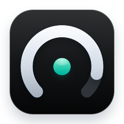
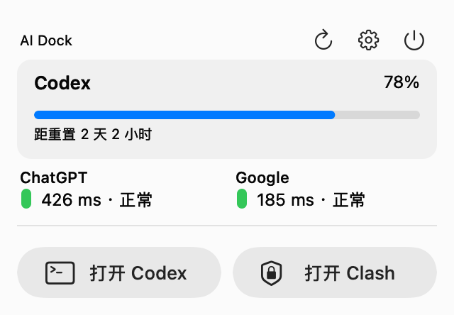
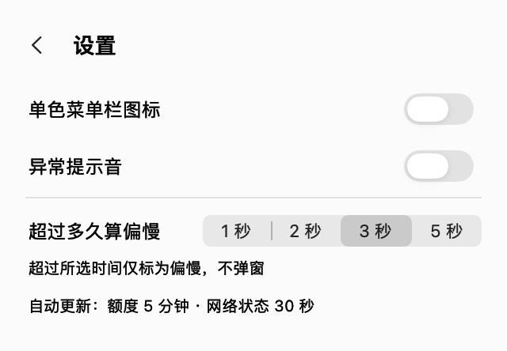
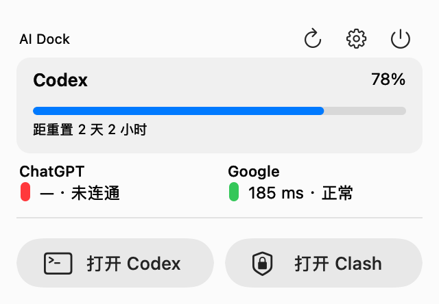
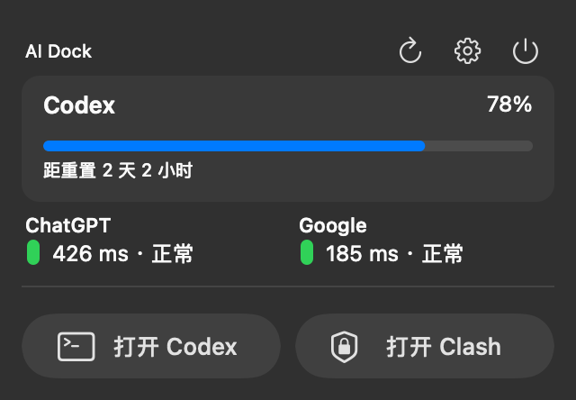
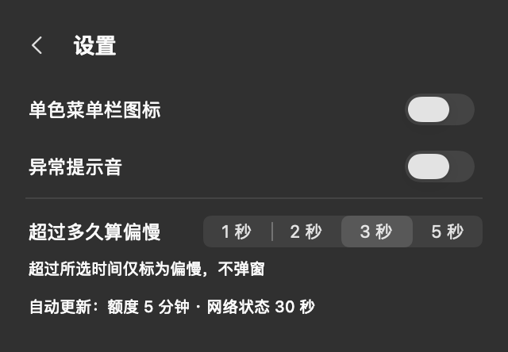

# AI Dock



一个轻量的原生 macOS 菜单栏工具。当前聚焦 **Codex 周额度、ChatGPT / Google 连通性、快捷启动与低打扰提醒**。

[产品定位与路线图](PRODUCT.md)记录已实现、正在收敛、待验证和远期探索，是后续产品评审与公开说明的依据。多 AI、多账号和通用额度中心目前都不是已交付能力。

## 界面预览

以下是当前原生视图代码生成的界面截图，使用固定示例数据，不含真实账户额度；系统弹出层阴影未包含，启动按钮使用审阅版中性图标。

| 状态面板 | 设置 |
| --- | --- |
|  |  |



| 深色面板 | 深色设置 |
| --- | --- |
|  |  |

## 能耗与稳定性

检测不是零成本：当前理论上每小时 240 次 HTTPS 探测、12 次额度 CLI 启动。一次空闲采样约 57 MiB 内存、0.0% CPU，未发现 AI Dock 防休眠断言；这不是续航测量，也不保证所有环境无冲突。[性能与能耗调研](PERFORMANCE.md)列出连接复用、减少隐藏界面重绘、自适应频率、睡眠恢复和子进程回收方案及验证计划，尚未实施这些优化。

## 使用

从“应用程序”打开 `/Applications/AI Dock.app`，或点击菜单栏额度弧。应用支持独立退出和重新打开；退出前会确认。现有旧名称快捷入口兼容新安装，应用身份保持不变以保留设置。

- **额度弧**：270° 轨道表示 Codex 周额度剩余；底部留缺口；额度未知使用虚线。
- **状态点**：显示 ChatGPT 独立探测状态，支持单色模式。它不证明 Codex 会话健康或代理已连接。
- **面板**：Codex 标题、右侧剩余百分比和进度条，下方显示重置倒计时；横向的 ChatGPT / Google 检测结果；固定的 Codex、Clash Verge 启动按钮。
- **操作**：刷新显示进行动画，成功后短暂显示勾选，部分失败显示提示标识；设置和退出位于右上角。

## 数据与隐私边界

额度读取通过已安装 ChatGPT 应用内的 Codex CLI 启动 `app-server --stdio`，调用 `account/rateLimits/read`。AI Dock 不直接读取认证文件，登录状态由 CLI 处理。当前没有账号选择或账号归属比对功能，也不能保证 CLI 与桌面界面当前所选账号始终一致。

当前实现选择 `codex` 额度桶中长度为 10080 分钟的窗口。没有对应窗口或读取失败时，不推断余额，显示不可用及读取原因。重置次数只在服务端返回正数时显示；零与不可用目前均隐藏，不把汇总次数擅自归属某个模型。

连通性每 30 秒独立检测一次：

| 目标 | 地址 | 成功条件 |
| --- | --- | --- |
| ChatGPT | `https://chatgpt.com/cdn-cgi/trace` | 最终响应为同主机 HTTPS 200 |
| Google | `https://www.google.com/generate_204` | 最终响应为同主机 HTTPS 204 |

使用临时 URLSession，不携带应用提供的凭据或 Cookie，不记录响应体，沿系统网络及代理规则访问。两个域名可能走不同路线；Google 可达不等于 VPN 已连接。上述描述来自应用代码核查，不等于已对 Codex CLI 或系统网络依赖做完整通信审计。

应用不改变代理连接、网络设置或登录凭据，不默认增加开机启动。当前仅将阈值、单色模式和提示音偏好存入本地 UserDefaults。

## 刷新与提醒

- Codex 额度每 5 分钟读取一次，也可手动刷新。
- 默认慢速阈值 3000 ms，可选 1000 / 2000 / 3000 / 5000 ms。
- 偏慢只显示状态，不弹窗。ChatGPT 连续 5 次失败才提醒；同轮故障一次；连续 3 次成功后重新启用，两次提醒至少间隔 30 分钟。
- 上述提醒计数和冷却只在当前运行期间保存。Google 不增加弹窗提醒。
- 提示音默认关闭；检测仅在应用运行时进行。

## 构建与验证

源码：`Sources/main.swift`；资源：`Resources/`。本机 CLI 接口参考 `Protocol/` 仅留在开发环境，不纳入仓库。

需要 macOS 和 Apple Command Line Tools：

```sh
bash build.sh
'build/AI Dock.app/Contents/MacOS/CodexCompanion' --self-test
```

可选诊断（会发出真实请求，并在终端显示额度信息；分享输出前检查隐私）：

```sh
'build/AI Dock.app/Contents/MacOS/CodexCompanion' --diagnose
```

构建使用本地 ad-hoc 签名，尚非面向公开分发的公证版本。读取额度依赖当前代码指定位置的 ChatGPT Codex CLI；Clash 启动入口目前也是固定位置。独立 `.app` 不代表这些运行依赖已消除。

已验证：构建、自测、签名；原设置迁移和单实例；Finder 启动、退出确认、重新打开；设置、刷新进行与完成反馈；关键额度异常的界面分支。真实未登录/登录过期、完整深浅色矩阵、睡眠唤醒及长期网络波动仍待验证，详见[路线图](PRODUCT.md)。

## 发布状态

源码与进度已同步至私有仓库 gocat/ai-dock。待产品满意后再决定开源，不自动公开发布。品牌资源及公开分发许可仍需核实，尤其是当前 Codex 本地单色适配稿。本项目不改变其他项目或仓库的可见性。


## 发布候选审阅

[发布审阅清单](RELEASE_REVIEW.md)与[拟发布说明](RELEASE_NOTES.md)已准备，私有仓库已确认；公开分发的许可证与版本尚未确认。

默认 `bash build.sh` 使用中性系统图标，并重新生成 AI Dock 自有应用图标；不打包开发阶段的第三方品牌资源，详见[资源说明](THIRD_PARTY.md)。`bash scripts/review-package.sh` 生成本地候选应用 ZIP、白名单源码 ZIP 和校验和。当前构建要求 macOS 14+、当前 Apple Command Line Tools 与 Python 3；目前仅在当前 Apple silicon Mac 实测，并未声称跨系统逐字节可复现。
